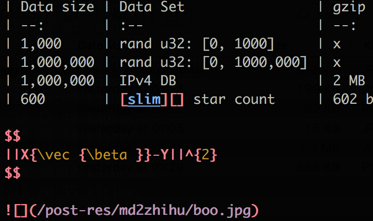
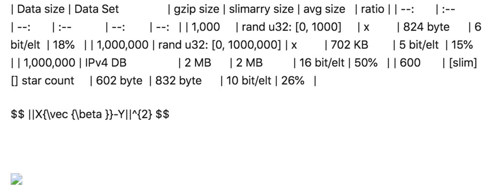
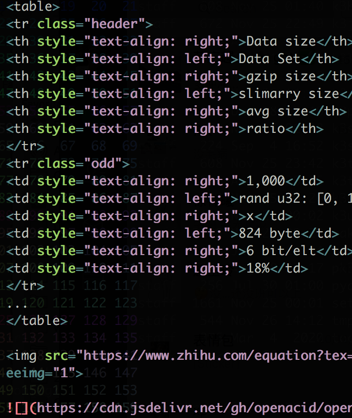
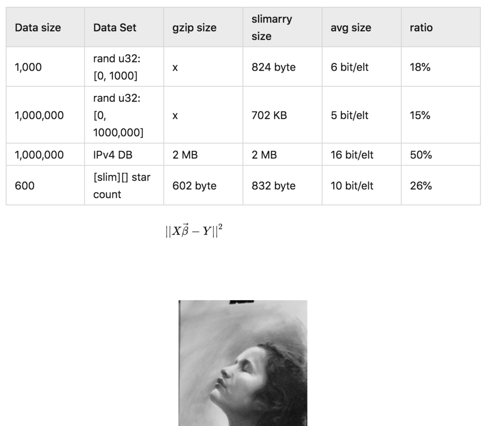
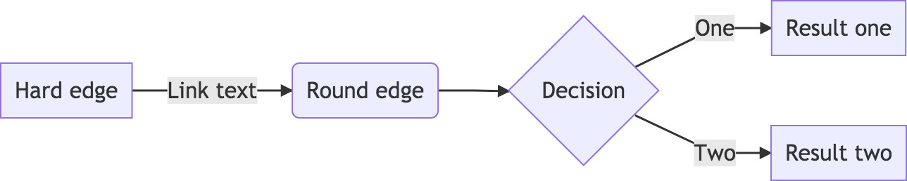
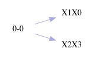
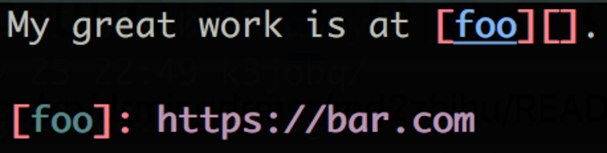
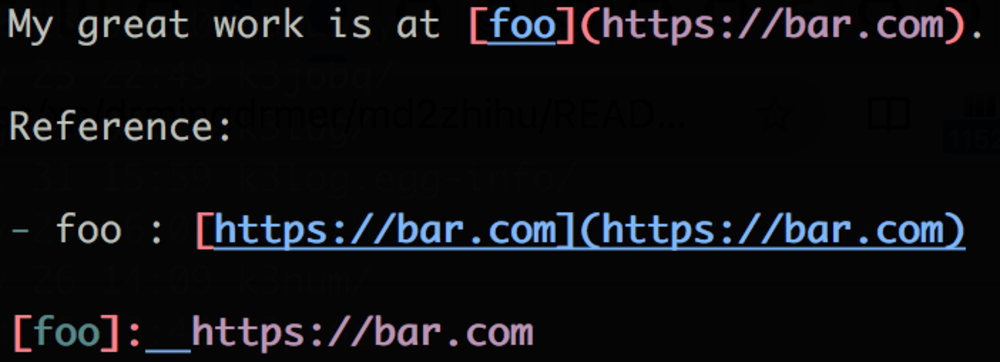
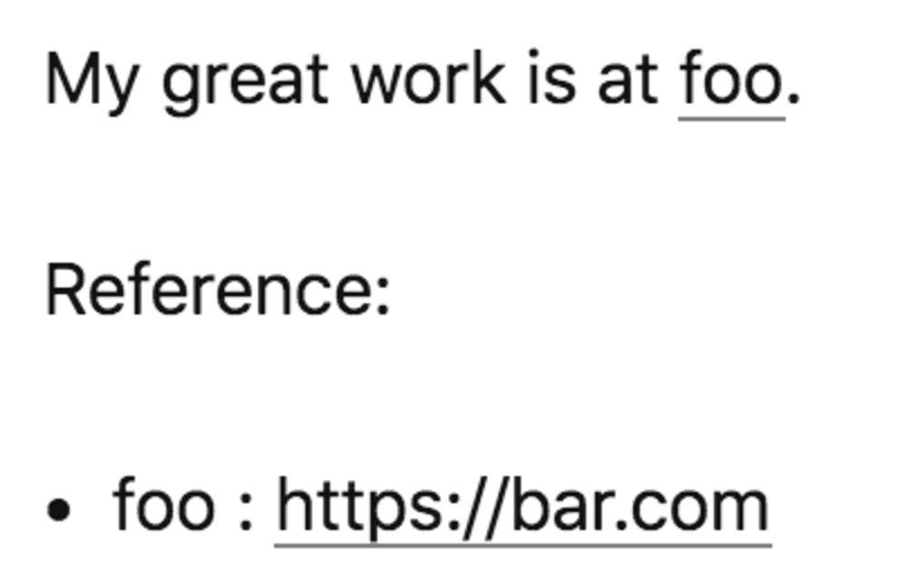

# md2zhihu

将 markdown 转换成 [知乎](zhihu.com) 兼容的 markdown 格式

[md2zhihu on Marketplace](https://github.com/marketplace/actions/md2zhihu)

|           | md                    | 导入后                 |
| :--       | :-:                   | :-:                    |
| 原始文件  |     |  |
| 转换后    |  |   |

# 使用方法

**md2zhihu 不支持 Windows**：[Issue: no module termios](https://github.com/drmingdrmer/md2zhihu/issues/7)。
请通过 GitHub Action 远程使用：

## 1. 通过 GitHub Action 远程使用：


将 github-action 添加到 Markdown 文件所在的 git 仓库：
`.github/workflows/md2zhihu.yml`：

```yaml
name: md2zhihu
on: [push]
jobs:
  md2zhihu:
    runs-on: ubuntu-latest
    permissions:
      contents: write
    steps:
      - uses: actions/checkout@v7

      # 转换：把转换后的 markdown 和图片写到 _md2zhihu 目录。
      - uses: drmingdrmer/md2zhihu@v0.23
        with:
          pattern: >
              _posts/*.md
              _posts/*.markdown

      # 发布：把带 _md2zhihu 的工作区推送到分支 <branch>-md2zhihu。
      - run: |
          git add _md2zhihu
          git -c user.name=md2zhihu -c user.email=noreply@localhost commit --allow-empty -m "md2zhihu built"
          git push -f origin HEAD:refs/heads/${{ github.ref_name }}-md2zhihu
```

每次推送都会运行这个 workflow。action 转换 `_posts/` 目录中的 Markdown 文件，
把结果写到工作区的 `_md2zhihu` 目录，`post.md` 的图片在 `_md2zhihu/post/` 中。
action 本身不推送任何东西。最后一步发布 `_md2zhihu`：它把工作区推送到一个分支，
分支名是被推送的分支名加上 `-md2zhihu`。推送 `master` 会创建 `master-md2zhihu`。
只有这一步写仓库，所以只有它需要 `permissions: contents: write`。

分支 `master`：
```
▾ _posts/
    2013-01-31-jobq.markdown
    2013-01-31-resource.markdown
    ...
```

分支 `master-md2zhihu`：
```
▾ _posts/
    2013-01-31-jobq.markdown
    2013-01-31-resource.markdown
    ...
▾ _md2zhihu/
    jobq.md
    jobq/
    resource.md
    resource/
    ...
```

转换后的 markdown 通过 jsDelivr 引用这个分支上的图片，例如
`https://cdn.jsdelivr.net/gh/<owner>/<repo>@master-md2zhihu/_md2zhihu/jobq/<hash>-a.png`。
知乎只能导入公开 URL 上的图片，所以最后一步推送分支之后，图片才能显示。
参数 `asset_url_prefix` 设置这个 URL。如果把 `_md2zhihu` 发布到别处，例如另一个仓库，
就把它设为 `_md2zhihu` 在那里的公开 URL。设为 `""` 则保留相对 URL。

获取转换后的 Markdown 文件有两种方法：
- `git fetch` 和 `git merge` `master-md2zhihu`分支。
- 或直接在 web 上访问此分支：
  [转换后的文件](https://github.com/drmingdrmer/drmingdrmer.github.io/blob/master/_md2zhihu/dict-cmp.md)

0.22 及之前版本的 action 自己把图片和转换后的 markdown 推送到两个分支。
要保留这个行为，请继续使用 `drmingdrmer/md2zhihu@v0.22`。

**md2zhihu 参数**

-   `pattern`：

    匹配要转换的文件

    **required**：False
    **default**：`**/*.md`

-   `output_dir`：

    存储转换后的 Markdown 和图片的目录

    **required**：False
    **default**：`_md2zhihu`

-   `asset_url_prefix`：

    `output_dir` 被 workflow 后面的步骤发布之后的公开 URL。
    md2zhihu 把它加在转换后的 markdown 中每个相对 URL 的前面，例如 `post.md` 的图片的 URL `post/<hash>-a.png`，
    这样知乎等平台就能从那里加载图片。
    action 不推送任何东西，所以只有 workflow 把 `output_dir` 发布到那里之后，这个 URL 才能访问。

    默认值是 jsDelivr 提供本仓库分支 `<branch>-md2zhihu` 上 `_md2zhihu/` 的 URL，
    即上面示例 workflow 推送的分支。修改 `output_dir` 或推送的分支时，也要同时修改它。

    指向其他文件的相对链接，例如 `../other.md`，也会加上这个前缀。
    设为 `""` 则保留所有相对 URL。

    **required**：False
    **default**：`https://cdn.jsdelivr.net/gh/${{ github.repository }}@${{ github.ref_name }}-md2zhihu/_md2zhihu/`

-   `target_platform`:

    转换后的 Markdown 应与指定的平台兼容。
    目前支持的平台有`zhihu`, `wechat`, `weibo`, `simple`。`simple` 将几乎所有内容(公式, 图表等)转换为图片，并删除大部分文本样式。
    例如，将内联代码块转换为普通文本。

    **required**: False
    **default**: `zhihu`

-   `image`:

    运行 md2zhihu 的 docker 镜像。每次运行前，action 都从镜像所在的仓库拉取它。
    设为一个发布版本，例如 `ghcr.io/drmingdrmer/md2zhihu:v0.23`，就会一直使用这个版本。
    0.22 及之前版本的镜像不能运行这个 action。要保留 0.22 的推送行为，请使用 `drmingdrmer/md2zhihu@v0.22`。

    **required**: False
    **default**: `ghcr.io/drmingdrmer/md2zhihu:latest`

## 2. 在笔记本上使用

**系统要求**

MaxOS

```sh
# 用于将表格渲染为 HTML，以及将 graphviz 渲染为图片
brew install pandoc graphviz node
npm install -g @mermaid-js/mermaid-cli mathjax-full@3.2.2
pip install md2zhihu
# 用于将 mermaid、代码块、表格和公式渲染为图片
playwright install chromium
```

**基本用法**：

```sh
md2zhihu your_great_work.md
```

此命令将 `your_great_work.md` 转换为 `_md2/your_great_work.md`，并把图片写到
`_md2/your_great_work/`。转换后的 markdown 用相对 URL 引用每张图片，例如
`your_great_work/<hash>-a.png`。md2zhihu 不推送任何东西，`_md2` 由你自己发布。

**用公开 URL 引用图片**：

知乎等平台只能导入公开 URL 上的图片。把 `_md2` 发布到公开的地方，例如推送到某个
GitHub 仓库的分支 `md2`，再把 `_md2` 在那里的 URL 告诉 md2zhihu：

```sh
md2zhihu your_great_work.md \
    --rewrite-if '^your_great_work/' '^' 'https://cdn.jsdelivr.net/gh/<owner>/<repo>@md2/'
```

这样 `your_great_work.md` 的图片 URL 就是
`https://cdn.jsdelivr.net/gh/<owner>/<repo>@md2/your_great_work/<hash>-a.png`。

三个 rewrite 参数修改输出中每个链接和图片的 URL：保存的图片、远程图片、指向其他页面的链接。
它们不修改其他文本。

- `--rewrite REGEX REPLACEMENT` 用 `re.sub(REGEX, REPLACEMENT, url)` 修改每个 URL。
  `--rewrite '^' 'https://cdn.example/'` 也会给远程图片的 URL 加前缀，例如 `https://a.com/x.png`。
- `--rewrite-if SELECTOR REGEX REPLACEMENT` 只修改 `re.search(SELECTOR, url)` 能找到匹配的 URL。
  只有 SELECTOR 匹配不会修改 URL：`REGEX` 也要匹配。
- `--rewrite-if-not SELECTOR REGEX REPLACEMENT` 只修改 `re.search(SELECTOR, url)` 找不到匹配的 URL。

这些规则按命令行中的顺序执行，每条规则处理上一条规则的结果。规则看到的是完整的 URL，
包括 query 和 fragment，并且在 md2zhihu 保存图片之后执行。使用 `--download` 时，
规则看到的是下载后的副本的 URL，而不是远程 URL。

要给所有相对 URL 加前缀，就排除带 scheme 或 host 的 URL（例如 `https:`、`//`、`data:`）、
从根开始的路径，以及只有 query 或 fragment 的引用（例如 `#intro`）：

```sh
md2zhihu your_great_work.md \
    --rewrite-if-not '^([A-Za-z][A-Za-z0-9+.-]*:|//|/|[?#]|$)' '^' 'https://cdn.jsdelivr.net/gh/<owner>/<repo>@md2/'
```

这条规则也会给指向其他文件的相对链接加前缀，例如 `../other-post.md`，因为 URL 本身无法区分
保存的图片和其他相对链接。只想修改保存的图片时，就选择图片所在的目录，如上面的
`--rewrite-if '^your_great_work/'`。这个 selector 匹配的是路径，所以你自己写的指向
`your_great_work/` 的链接也会被匹配。

md2zhihu 0.22 及之前版本用 `-r` 和 `-b` 推送 `_md2`。现在这两个参数会报错退出。
要保留推送，请使用 `pip install md2zhihu==0.22`。

**其他选项**：`md2zhihu --help`

### 故障排查


- **command not found: md2zhihu**

  尝试以下步骤：

  - `pip install --verbose md2zhihu` 确认已成功安装。
  - `which md2zhihu` 确认可以找到二进制文件，例如：`/Users/drdrxp/xp/py3virtual/p38/bin/md2zhihu`。
  - `echo $PATH` 确认安装路径已包含在 `PATH` 中：`...:/Users/drdrxp/xp/py3virtual/p38/bin:...`

- workflow 中的 `git push` 步骤报错: **remote: Permission to ... denied to github-actions**

  ```
  remote: Permission to <your_repo>.git denied to github-actions[bot].
  fatal: unable to access 'https://github.com/<your_name>/<your_repo>.git/': The requested URL returned error: 403
  ```

  尝试以下步骤：

  - 进入repo settings
  - 点击 "Action" 下拉菜单
  - 然后点击 "General"
  - 向下滚动一点，直到你看到 "Workflow permissions"
  - 它可能设置在 "Read repository contents and packages permissions"
  - 点击 "Read and write permissions"
  - 向下滚动并保存。

## 3. 通过 Docker 使用

镜像 `ghcr.io/drmingdrmer/md2zhihu` 包含 md2zhihu 及其需要的全部工具。
在 Markdown 文件所在目录中运行：

```sh
docker run --rm -v "${PWD}:/work" ghcr.io/drmingdrmer/md2zhihu md2zhihu your_great_work.md
```

此命令将 `your_great_work.md` 转换为 `_md2/your_great_work.md`，
图片保存在 `_md2/your_great_work/` 中。加上[在笔记本上使用](#2-在笔记本上使用)中的
rewrite 参数，就能用你发布 `_md2` 的公开 URL 引用图片。

# Features

- 将 LaTeX 转换为图片：

  例如，` $$ ||X{\vec {\beta }}-Y||^{2} $$ ` 被转换为
  

- 将表格转换为 HTML。

- 将图片和链接指向的本地文件（如 `[论文](paper.pdf)`）复制到输出目录，
  用相对 URL 引用它们，或用 rewrite 参数给出的公开 URL 引用它们。

- 将 mermaid 代码块转换为图片：

    ```
    graph LR
        A[Hard edge] -->|Link text| B(Round edge)
        B --> C{Decision}
        C -->|One| D[Result one]
        C -->|Two| E[Result two]
    ```

    被转换为：

    

- 将 graphviz 代码块转换为图片：

    ```graphviz
    digraph R {
        node [shape=plaintext]
        rankdir=LR
        X0X0 [ label="0-0"]
        X0X0 -> X1X0 [ color="#aaaadd"]
        X0X0 -> X2X3 [ color="#aaaadd"]
    }
    ```
    被转换为：

    

- 生成链接列表：

    | 原始 | 转换后 | 导入后 |
    | :-: | :-: | :-: |
    |  |  |  |


# Limitation

- 知乎不支持表格单元格内的 Markdown 语法。
  这些在表格单元格内的内容将被转换为纯文本。

- md2zhihu 无法处理 Jekyll/GitHub 页面标签。例如，``。

