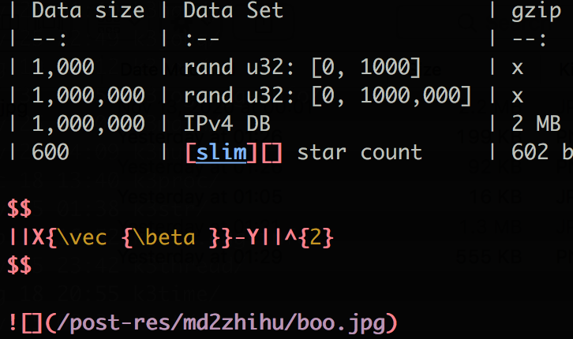
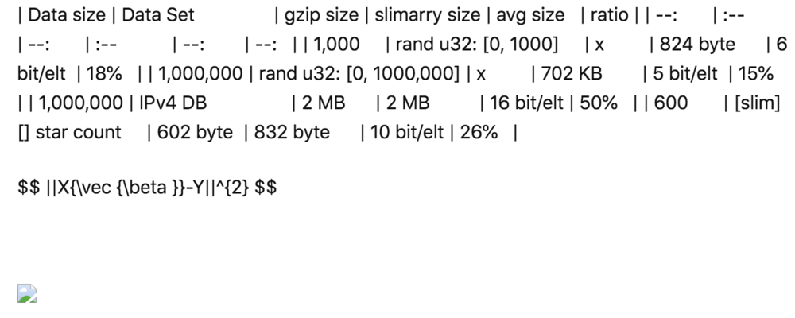
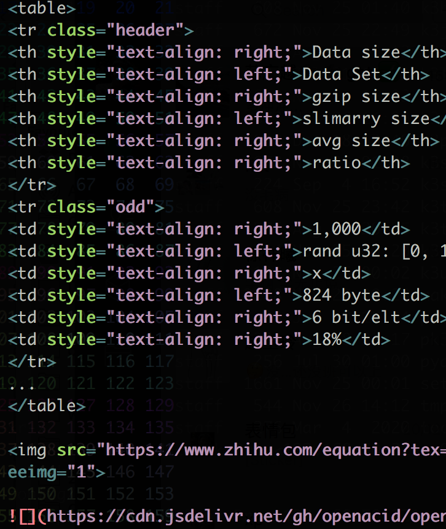
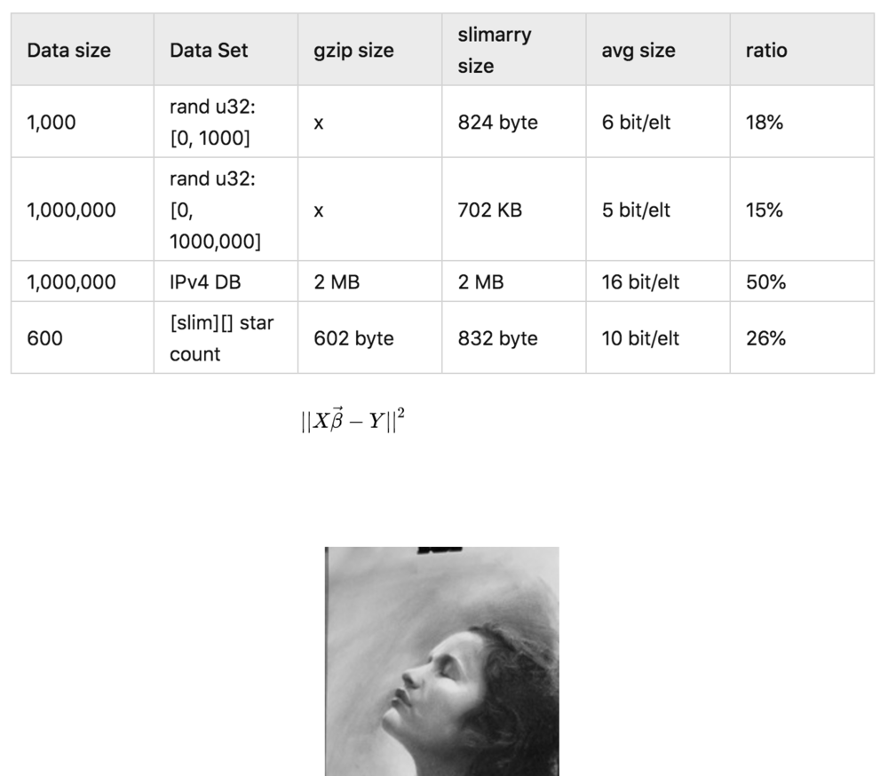
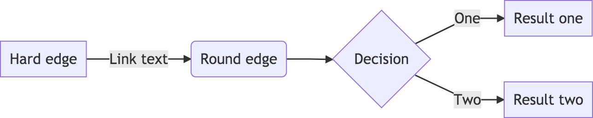
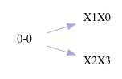
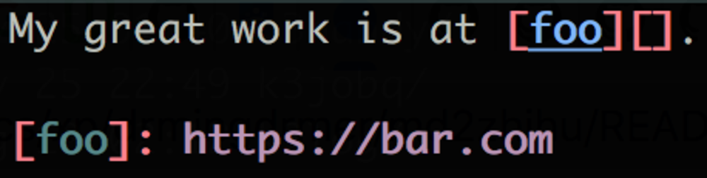
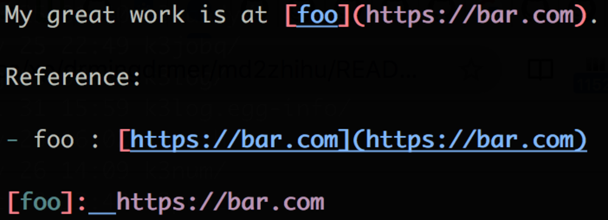
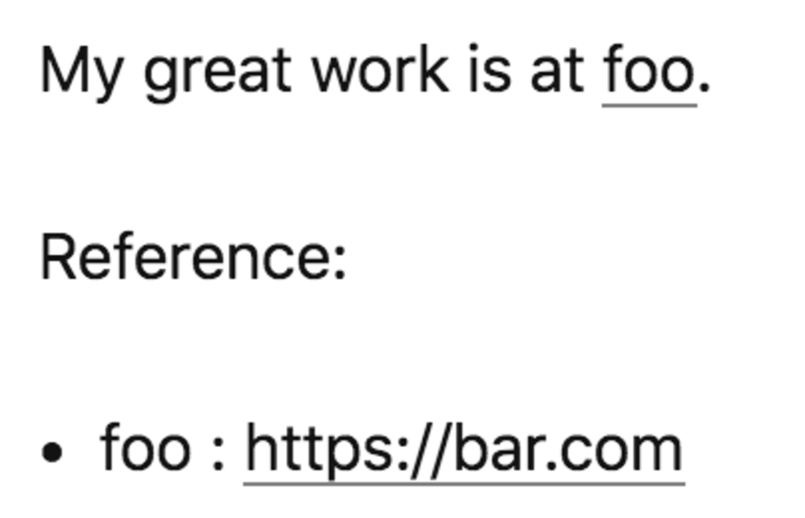

# md2zhihu

中文介绍在: [md2zhihu-中文介绍](https://github.com/drmingdrmer/md2zhihu/blob/main/README-cn.md).

Converts markdown into a single-file version without local asset dependencies,
which can be directly imported into [zhihu.com](https://www.zhihu.com) or other social
platforms with a single click.

|           | md                    | imported               |
| :--       | :-:                   | :-:                    |
| original  |     |  |
| converted |  |   |

# Usage

**md2zhihu DOES NOT support Windows**: [Issue: no module termios](https://github.com/drmingdrmer/md2zhihu/issues/7).
Use it remotely with GitHub Action:

## 1. Use it remotely with GitHub Action:

This is the recommended method since you do not need to install anything
locally. Only `git` is required.

Add the action configuration into the git repository where your markdown files
are located for conversion:
`.github/workflows/md2zhihu.yml`:

```yaml
name: md2zhihu
on: [push]
jobs:
  md2zhihu:
    runs-on: ubuntu-latest
    permissions:
      contents: write
    steps:
      - uses: actions/checkout@v7

      # Convert: write the converted markdown and its images into _md2zhihu.
      - uses: drmingdrmer/md2zhihu@v0.23

      # Publish: push the workspace with _md2zhihu to the branch <branch>-md2zhihu.
      - run: |
          git add _md2zhihu
          git -c user.name=md2zhihu -c user.email=noreply@localhost commit --allow-empty -m "md2zhihu built"
          git push -f origin HEAD:refs/heads/${{ github.ref_name }}-md2zhihu
```

A push runs this workflow. The action converts each markdown file and writes
the result into `_md2zhihu` in the workspace, with the images of `post.md` in
`_md2zhihu/post/`. The action pushes nothing. The last step publishes
`_md2zhihu`: it pushes the workspace to a branch named after the branch that
was pushed, with `-md2zhihu` added. A push to `main` creates `main-md2zhihu`.
That step is the only one that writes to the repo, so it is the only reason
for `permissions: contents: write`.

Branch `main`:
```
▾ _posts/
    2013-01-31-jobq.markdown
    2013-01-31-resource.markdown
    ...
```

Branch `main-md2zhihu`:
```
▾ _posts/
    2013-01-31-jobq.markdown
    2013-01-31-resource.markdown
    ...
▾ _md2zhihu/
    jobq.md
    jobq/
    resource.md
    resource/
    ...
```

The converted markdown refers to each image by its URL on that branch, through
jsDelivr, such as
`https://cdn.jsdelivr.net/gh/<owner>/<repo>@main-md2zhihu/_md2zhihu/jobq/<hash>-a.png`.
zhihu.com loads an image only from a public URL, so the images show once the
last step has pushed the branch. The input `asset_url_prefix` sets this URL. If
you publish `_md2zhihu` elsewhere, such as to another repo, set it to the
public URL of `_md2zhihu` there. To keep relative image URLs, set it to `""`.

There are two ways to get the converted markdown files:
- `git fetch` and `git merge` the branch `main-md2zhihu`.
- Or access this branch directly on the web:
  [single-file example](https://github.com/drmingdrmer/drmingdrmer.github.io/blob/master/_md2zhihu/dict-cmp.md)

The action of 0.22 and earlier pushed the images and the converted markdown
itself, to two branches. To keep that, stay on `drmingdrmer/md2zhihu@v0.22`.

**Action Options for md2zhihu**

-   `pattern`:

    file pattern to convert

    **required**: False
    **default**: `**/*.md`

-   `output_dir`:

    dir to store converted markdown.

    **required**: False
    **default**: `_md2zhihu`

-   `asset_url_prefix`:

    The public URL of `output_dir` once a later step of the workflow publishes it.
    md2zhihu puts it before each relative URL of the converted markdown, such as `post/<hash>-a.png` of an image of `post.md`,
    so that a platform such as zhihu.com loads the image from there.
    The action pushes nothing, so the URL works only after the workflow publishes `output_dir` at that place.

    The default is the URL that jsDelivr serves `_md2zhihu/` at, on the branch `<branch>-md2zhihu` of this repo,
    which the example workflow in README.md pushes.
    Change it together with `output_dir`, or with the branch that the workflow pushes.

    A relative link to another file, such as `../other.md`, also gets the prefix.
    Set it to "" to keep every relative URL as it is.

    **required**: False
    **default**: `https://cdn.jsdelivr.net/gh/${{ github.repository }}@${{ github.ref_name }}-md2zhihu/_md2zhihu/`

-   `target_platform`:

    The platform that the converted markdown should be compatible to.

    Currently supported platforms are zhihu, wechat, weibo, simple.
    `simple` converts almost everything to images and removes most text styles.
    E.g. inline code block is converted to normal text.

    **required**: False
    **default**: `zhihu`

-   `image`:

    The docker image that runs md2zhihu. The action pulls it from its registry before each run.
    Set it to a release, such as `ghcr.io/drmingdrmer/md2zhihu:v0.23`, to keep using that release.
    An image of 0.22 or earlier can not run this action. To keep the push of 0.22, use `drmingdrmer/md2zhihu@v0.22`.

    **required**: False
    **default**: `ghcr.io/drmingdrmer/md2zhihu:latest`


## 2. Use it on your laptop

**System requirements**

macOS

```sh
# For rendering table to html, and graphviz to images
brew install pandoc graphviz node
npm install -g @mermaid-js/mermaid-cli mathjax-full@3.2.2
pip install md2zhihu
# For rendering mermaid, code blocks, tables and math to images
playwright install chromium
```

**Basic usage**:

```sh
md2zhihu your_great_work.md
```

This command converts `your_great_work.md` to `_md2/your_great_work.md`, and
writes its images into `_md2/your_great_work/`. The converted markdown refers
to each image by a relative URL, such as `your_great_work/<hash>-a.png`.
md2zhihu pushes nothing: publishing `_md2` is up to you.

**Refer to the images by a public URL**:

zhihu.com and the other platforms load an image only from a public URL. Publish
`_md2` somewhere public, such as by pushing it to the branch `md2` of a GitHub
repo, and give md2zhihu the URL that `_md2` gets there:

```sh
md2zhihu your_great_work.md \
    --rewrite-if '^your_great_work/' '^' 'https://cdn.jsdelivr.net/gh/<owner>/<repo>@md2/'
```

The images of `your_great_work.md` then have URLs such as
`https://cdn.jsdelivr.net/gh/<owner>/<repo>@md2/your_great_work/<hash>-a.png`.

The three rewrite flags change the URL destination of each link and image of
the output: a stored image, a remote image, and a link to another page. They
do not change any other text.

- `--rewrite REGEX REPLACEMENT` changes every destination with
  `re.sub(REGEX, REPLACEMENT, url)`. `--rewrite '^' 'https://cdn.example/'`
  also prefixes the URL of a remote image, such as `https://a.com/x.png`.
- `--rewrite-if SELECTOR REGEX REPLACEMENT` changes only a destination in which
  `re.search(SELECTOR, url)` finds a match. A match alone does not change it:
  `REGEX` must match too.
- `--rewrite-if-not SELECTOR REGEX REPLACEMENT` changes only a destination in
  which `re.search(SELECTOR, url)` finds no match.

The rules apply in the order of the command line, each to the URL that the rule
before it made. They see the whole URL, with its query and fragment, after
md2zhihu has stored the images. With `--download`, a rule sees the URL of the
downloaded copy, not the remote URL.

To prefix every relative destination, leave out the URLs with a scheme or a
host, such as `https:`, `//` and `data:`, the paths from the root, and the
references to a query or a fragment, such as `#intro`:

```sh
md2zhihu your_great_work.md \
    --rewrite-if-not '^([A-Za-z][A-Za-z0-9+.-]*:|//|/|[?#]|$)' '^' 'https://cdn.jsdelivr.net/gh/<owner>/<repo>@md2/'
```

This rule also prefixes a relative link to another file, such as
`../other-post.md`, because nothing in a URL tells a stored image from another
relative link. To change only the stored images, select their folder, as
`--rewrite-if '^your_great_work/'` above does. That selector matches a path, so
it also matches a link to `your_great_work/` that you wrote yourself.

md2zhihu 0.22 and earlier pushed `_md2` with `-r` and `-b`. These flags now
exit with an error. To keep the push, use `pip install md2zhihu==0.22`.

**Other options**: `md2zhihu --help`

### Trouble shoot

- **command not found: md2zhihu**

  Try:

  - `pip install --verbose md2zhihu` Confirm that install done successfully.
  - `which md2zhihu` Confirm that the binary can be found. The path it prints is the install path.
  - `echo $PATH` Confirm that this path is included in `PATH`.

- The `git push` step of the workflow complains about permission: **remote: Permission to ... denied to github-actions**

  ```
  remote: Permission to <your_repo>.git denied to github-actions[bot].
  fatal: unable to access 'https://github.com/<your_name>/<your_repo>.git/': The requested URL returned error: 403
  ```

  Try:

  - Navigate into the repo settings
  - Click the "Action" dropdown
  - Then "General"
  - Scroll down a little till you see "Workflow permissions"
  - It is probably on "Read repository contents and packages permissions"
  - Click "Read and write permissions"
  - Scroll down and save.

## 3. Use it with Docker

The image `ghcr.io/drmingdrmer/md2zhihu` contains md2zhihu and all the tools it needs.
Run it in the dir that contains the markdown:

```sh
docker run --rm -v "${PWD}:/work" ghcr.io/drmingdrmer/md2zhihu md2zhihu your_great_work.md
```

This command converts `your_great_work.md` to `_md2/your_great_work.md`,
and saves the images in `_md2/your_great_work/`. Add the rewrite flags of
[Use it on your laptop](#2-use-it-on-your-laptop) to refer to the images by
the public URL that you publish `_md2` at.

# Features

- Transform latex to image:

  E.g. ` $$ ||X{\vec {\beta }}-Y||^{2} $$ ` is converted to
  

- Transform table to HTML.

- Copy images, and the local files that links refer to, such as `[paper](paper.pdf)`, into the output folder,
  and refer to them by relative URLs, or by the public URLs that the rewrite flags give.

- Transform mermaid code block to image:

    ```
    graph LR
        A[Hard edge] -->|Link text| B(Round edge)
        B --> C{Decision}
        C -->|One| D[Result one]
        C -->|Two| E[Result two]
    ```

    is converted to:

    


- Transform graphviz code block to image:

    ```graphviz
    digraph R {
        node [shape=plaintext]
        rankdir=LR
        X0X0 [ label="0-0"]
        X0X0 -> X1X0 [ color="#aaaadd"]
        X0X0 -> X2X3 [ color="#aaaadd"]
    }
    ```
    is converted to:

    


-   Generate link list:

    | original | converted | imported |
    | :-: | :-: | :-: |
    |  |  |  |


# Limitation

- zhihu.com does not support markdown syntax inside a table cell.
  These in-table-cell content are transformed into plain text.

- md2zhihu can not deal with jekyll/github page tags. E.g. ``.
